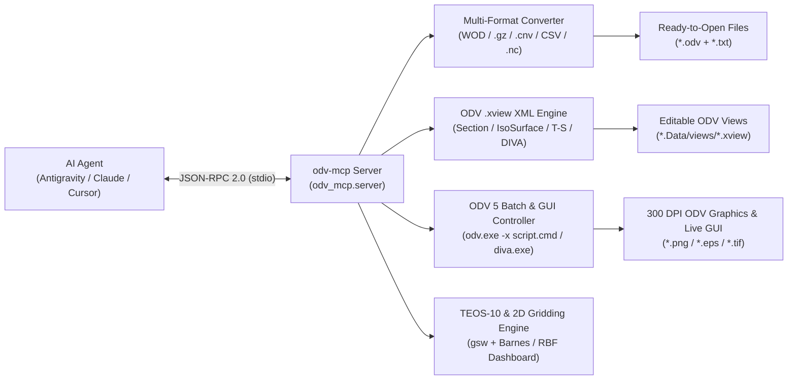

# `odv-mcp` — Ocean Data View (ODV 5) Model Context Protocol (MCP) Server & AI Automation Engine

[](LICENSE)
[](https://www.python.org/)
[](https://modelcontextprotocol.io/)
[](https://odv.awi.de/)

**`odv-mcp`** bridges **Ocean Data View (ODV 5)** with AI Agents (**Antigravity, Claude Desktop, Cursor, Windsurf, Cline**) via the **Model Context Protocol (MCP)**.

With `odv-mcp`, an AI agent can take raw oceanographic datasets (such as **World Ocean Database `CTDO1012.gz`**, **Sea-Bird CTD `.cnv`**, **CSV/Excel**, or **NetCDF `.nc`**) and automatically:
1. **Generate ready-to-open native ODV Collections (`.odv` + `.Data/`)** and **ODV Generic Spreadsheets V4.8 (`.txt`)**.
2. **Author and live-edit ODV View XML files (`.xview`)** with full control over window layouts (**Station Profiles**, **T-S Scatter Diagrams with Isopycnals $\sigma_\theta$**, **Vertical Sections with GEBCO Bathymetry**, and **Horizontal Iso-Surface Maps**).
3. **Control Spatial Interpolation & Gridding** (`DIVA` finite-element optimal interpolation via `diva.exe`, `Weighted-Average / Barnes` gridding, `Quick` gridding, or `Original` discrete data).
4. **Drive `odv.exe` in headless batch mode (`.cmd`) or interactive GUI mode**, exporting 300+ DPI publication graphics (`.png`, `.gif`, `.jpg`, `.eps`, `.tif`) while keeping views 100% editable inside the ODV desktop application.

---

## Architecture



---

## Features & Exposed MCP Tools

| Tool Name | Description |
| :--- | :--- |
| `odv_environment_status` | Detects local `odv.exe`, `diva.exe` (DIVA gridding), `GEBCO` bathymetry, and installed `.pal` color palettes (`cmocean_thermal`, `cmocean_haline`, `cmocean_oxy`, `ODV_Default`, `Viridis`, etc.). |
| `odv_import_to_collection` | Decompresses `.gz` archives if needed, detects format (`WORLDOCEANDATABASE`, `SPREADSHEET`, `SEABIRD_CNV`, `TABULAR_CSV_EXCEL`, `NETCDF`), creates a ready-to-open `.odv` collection, and exports a clean ODV Generic Spreadsheet (`.txt`). |
| `odv_inspect_collection` | Parses `.odv` metadata, data variables (with 0-based `.xview` IDs), station count, geographic domain (`lon_min..lon_max`, `lat_min..lat_max`), principal transect waypoints, variable statistics, and existing `.xview` files. |
| `odv_create_plot` | Generates a native `.xview` view (`section`, `surface`, `scatter`, `ts_diagram`, `station`) with configurable interpolation (`diva`, `weighted_average`, `quick`, `original`), smoothing length scales, color palettes, contours, and T-S isopycnals; renders via `odv.exe` and optionally opens in ODV GUI. |
| `odv_edit_view` | Modifies any existing `.xview` file in-place or to a new file (switching gridding algorithms, changing variables, palettes, color limits, contours, or section waypoints) and re-renders via `odv.exe`. |
| `odv_render_dashboard` | Produces a 4-panel hydrographic synthesis figure (Station Map + TEOS-10 T-S Diagram with $\sigma_0$ isopycnals + Interpolated Vertical Section + Interpolated Horizontal Iso-Surface Map). |
| `odv_run_command_file` | Executes raw ODV batch command lines (`.cmd` syntax) directly on `odv.exe`. |
| `odv_open_gui` | Launches the interactive Ocean Data View desktop application (`odv.exe`) with a target `.odv` collection and `.xview` view pre-loaded. |

---

## Installation

```bash
git clone https://github.com/dzakyzahy/odv-mcp.git
cd odv-mcp
pip install -e .
```

Optional TEOS-10 (`gsw`) and NetCDF support:
```bash
pip install -e ".[teos10,netcdf]"
```

---

## Connecting to AI Agents (MCP Configuration)

Add `odv-mcp` to your `mcp_config.json` (Antigravity / Cursor / Windsurf) or `claude_desktop_config.json` (Claude Desktop):

```json
{
  "mcpServers": {
    "odv-mcp": {
      "command": "python",
      "args": ["-m", "odv_mcp", "serve"],
      "env": {
        "ODV_EXECUTABLE": "C:\\Program Files\\Ocean Data View\\bin_w64\\odv.exe"
      }
    }
  }
}
```

---

## Example Natural Language Prompts for AI Agents

Once `odv-mcp` is connected, you can command your AI agent directly:

- *"Import `CTDO1012.gz` into a ready-to-open ODV collection and show me all available variables and geographic bounds."*
- *"Create an ODV vertical section plot of Temperature from 0 to 1000 m with DIVA interpolation and `cmocean_thermal` palette, save the `.xview`, and export a 300 DPI PNG."*
- *"Create an ODV horizontal surface map of Salinity at 50 m depth using Weighted-Average gridding and open it in the ODV GUI."*
- *"Edit the existing `Section_Temperature_DIVA.xview` view to display Oxygen instead of Temperature with `cmocean_oxy` palette and re-render."*
- *"Generate a 4-panel TEOS-10 hydrographic dashboard (Station Map, T-S Diagram with isopycnals, Vertical Section, and 100 m Iso-Surface Map)."*

---

## Command-Line Interface (CLI)

`odv-mcp` also includes a full terminal CLI:

```bash
# 1. Check ODV 5 & DIVA installation status
python -m odv_mcp status

# 2. Convert & import raw WOD / CTD / CSV file into a ready-to-open .odv collection
python -m odv_mcp import CTDO1012.gz -o CTDO1012_Ready.odv

# 3. Inspect variables, station count, and geographic bounding box
python -m odv_mcp inspect CTDO1012_Ready.odv

# 4. Create an ODV .xview with DIVA interpolation & render 300 DPI PNG
python -m odv_mcp plot CTDO1012_Ready.odv --type section --z-var Temperature --interp diva --max-depth 1000 --view-name Section_Temp_DIVA -o Section_Temp_DIVA.png

# 5. Render a 4-panel TEOS-10 + DIVA/Barnes synthesis dashboard
python -m odv_mcp dashboard CTDO1012_Ready.odv --z-var Temperature --iso-depth 50 --max-depth 1000 --interp diva -o Dashboard_CTDO1012.png
```

---

## License

MIT License © 2026 Dzaky Zahy Rabbani (Oceanography, FITB ITB).
